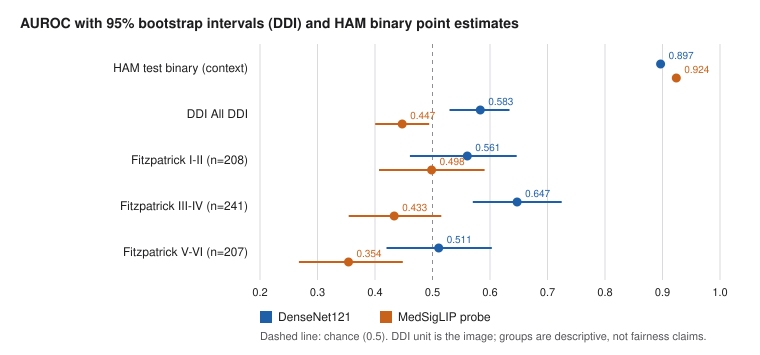

# DermDetect-R

**A protocol-locked rebuild of DermDetect-AI. It compares frozen MedSigLIP embeddings with an ImageNet DenseNet121 on skin-lesion images, from a leakage-safe split through calibration and a single external test, to measured compute cost.**

Status, November 2026: the study is complete. The results come from single locked runs and have not been peer-reviewed. This is research only, not a clinical tool.

[Final report](docs/final_experiment_report.md) · [Model card](docs/model_card.md) · [Data statement](docs/data_statement.md) · [Reproducibility and evidence map](docs/reproducibility.md) · [Protocol](docs/METHODS_AND_STATUS.md)

## Why this project exists

DermDetect-AI began as an educational prototype: a DenseNet121 classifier behind a Streamlit app, which reported **91.68% accuracy**. An audit found that number could not be trusted as a measure of performance:
- it came from the same validation data used to pick the model;
- lesion and patient separation were never shown;
- training could not be reproduced from the notebooks;
- the app preprocessed images differently from training;
- its confidence scores were uncalibrated.

None of this is unusual. It is how many medical-imaging results end up overstated.

So the prototype was rebuilt as a controlled experiment around one practical question:

> Under limited compute, how do frozen medical foundation-model embeddings (MedSigLIP) and a conventional ImageNet-pretrained DenseNet121 compare in class-balanced performance, calibration, selective prediction and end-to-end cost, on the same leakage-safe HAM10000 split? And how well do both transfer to clinical photographs across skin tones (DDI)?

The question matters because a frozen foundation model plus a linear probe is the cheapest way to adapt AI to a new medical task. Whether that shortcut is accurate, well calibrated and robust, and what it costs, are usually asserted rather than measured.

## What we found

| | DenseNet121 | MedSigLIP probe | MedSigLIP − DenseNet (95% CI) |
|---|---:|---:|---|
| HAM test, seven-class macro-F1 | 0.644 | **0.710** | +0.018 to +0.111 |
| HAM test, seven-class Brier (lower is better) | 0.274 | **0.227** | −0.074 to −0.019 |
| HAM test, binary AUROC | 0.897 | **0.924** | |
| **DDI clinical photos, AUROC** | **0.583** | 0.447 | −0.201 to −0.077 |
| L4 accelerator time to adapt | 6,442 s | **1,959 s** | |
| CPU inference per image | **0.1 s** | 6.8–7.9 s | |

- **On dermoscopy (HAM10000)**, the MedSigLIP probe was more accurate and better calibrated, and it abstained more usefully. It needed about a third of DenseNet's accelerator time to adapt.
- **The trade-off** is inference: MedSigLIP is about 70–80× slower per image on CPU, and its weights are about 70× larger.
- **On clinical photographs (DDI)**, both systems lost most of their ability to tell malignant from benign. DenseNet stayed weakly above chance; MedSigLIP fell slightly below it. Both were lowest in Fitzpatrick V–VI. These group results are descriptive, with wide intervals, and are not a fairness claim.
- **Takeaway:** an advantage on one image type did not carry over to another. Domain-matched validation is required before any practical use.



The full results, figures, per-class detail and compute ledger are in the [final report](docs/final_experiment_report.md).

## Why the results can be trusted

The point of the rebuild was to make each number traceable, and to make it hard to fool ourselves:
- **Leakage-safe data.** All 10,015 HAM images were checked for exact and near duplicates. 665 candidate pairs were reviewed, with source, agent and human decisions recorded separately. Images were grouped into 7,449 physical lesions before a sealed 70/15/15 split. Uncertain links were kept together, never silently merged or dropped.
- **Decisions made before results.** All four systems were frozen in a joint lock before any test outcome was seen: checkpoints, probes, temperatures, decision thresholds and the evaluator code. That includes seven-class and binary versions of each model. The DDI rules were locked separately before any DDI label was read.
- **One shot per test set.** The HAM test and DDI were each evaluated once by a supervised runner. Metrics were recorded before any error review, with no reruns, no tuning on test data and no threshold shopping.
- **Uncertainty, not just accuracy.** The evaluation reports calibration (Brier, NLL, ECE, reliability diagrams), abstention at fixed coverage, and paired bootstrap intervals for every primary comparison.
- **An external test.** DDI is a different modality (clinical photos), has a different disease mix and covers predefined skin-tone groups.
- **Real cost accounting.** GPU, CPU, storage and money are measured per stage, and first-run cost is kept separate from cached re-adaptation.
- **Negative findings kept.** The DDI collapse, inconclusive comparisons, failed runs and one protocol deviation are all reported, not hidden.
- **Replayable.** Recomputing the HAM metrics from the saved predictions with the locked code reproduces every number exactly. 647 tests pass.

## What this does not show

- No clinical, diagnostic, safety or fairness claim follows from this work.
- It compares **complete systems**: architecture, input resolution, adaptation method and pretraining data all differ, so no difference can be credited to medical pretraining alone.
- The evidence base is one training seed, one split, and validation data reused for model selection and calibration.
- DDI has no patient IDs, so DDI intervals treat each image as independent.
- See the report's limitations and deviations sections.

## Repository map

| Path | Contents |
|---|---|
| `docs/` | Protocol, final report, model card, data statement, reproducibility guide, claim ledger, milestone tracker and decision records |
| `src/dermdetect/` | Data contracts, model wrappers, probes and calibration, the locked evaluator and metrics, and the DDI adapter |
| `scripts/` | Supervised runners for each stage |
| `tests/` | 647 tests on invented or synthetic data |
| `requirements-m3-model-dev*.txt` | Pinned Python 3.11 environment (hash lock) |
| `Notebooks/`, `app.py`, `model/` | The original prototype, preserved as history; not the rebuilt pipeline |

Run the test suite:

```bash
PYTHONPATH=src:tests python -m unittest discover -s tests
```

Real data, weights and caches are not distributed. Rebuilding needs HAM10000, the pinned weights (including accepting MedSigLIP's terms) and an accelerator; see [reproducibility](docs/reproducibility.md).

## Human and AI-agent contributions

The author set the research question and the scientific and compute boundaries, and approved every gate. Those gates covered data access, split, lock, unseal, spend and retention. The author also made the required human visual-audit decisions and controlled provider spending. AI coding agents implemented and tested the code, prepared review packages, ran the approved jobs, and documented failures and limits. Agent recommendations and human decisions are recorded separately throughout (human review log (private record)).

## Data and licences

- **HAM10000:** Harvard Dataverse, DOI 10.7910/DVN/DBW86T, CC BY-NC 4.0.
- **DDI:** used under its research terms (non-commercial, non-clinical, no redistribution). Only aggregate results are reported; no DDI images or per-image outputs are stored or shared.
- **MedSigLIP:** Health AI Developer Foundations terms.
- **This repository** contains no research images, patient data, credentials or trained research weights.

## The original prototype

The historical DermDetect-AI app (`app.py`, `model/optimisedmodel121.h5`, `Notebooks/`) is kept unchanged for provenance. Its scores are uncalibrated, its SSIM "relevance" filter is unvalidated, and its metrics are not independent-test evidence. Do not use it, or anything here, to guide diagnosis or treatment, and do not upload identifiable medical images to any demo.
